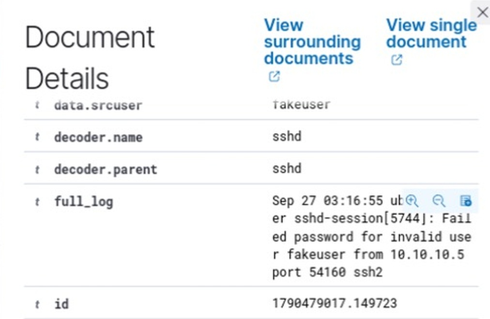
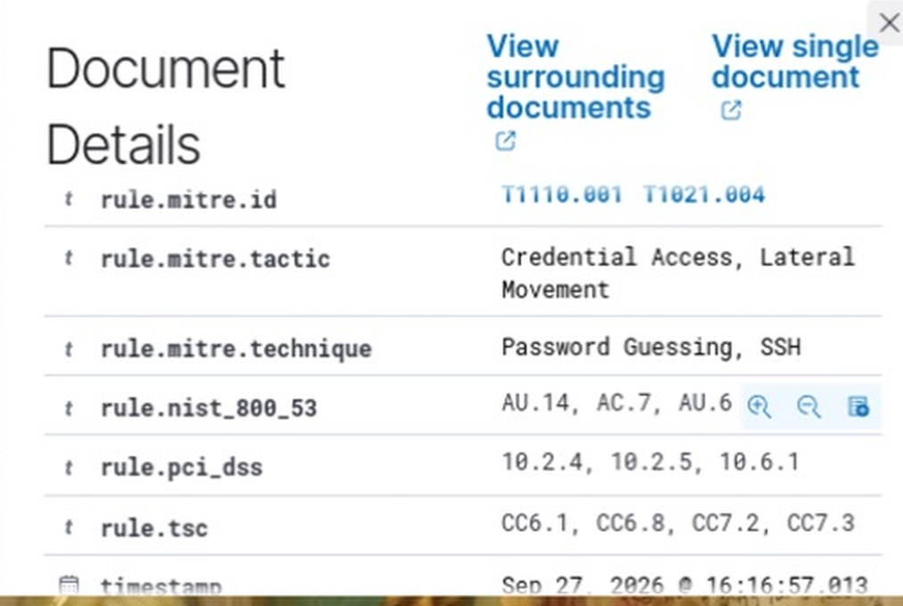

# Home SOC Lab

A self-built Security Operations Center lab for hands-on detection engineering practice, running entirely on a MacBook Air (Apple Silicon) using VMware Fusion.

## Overview

This lab simulates a small monitored network: an isolated attacker machine, a monitored target, and a SIEM collecting and alerting on activity between them. Built from scratch as part of my transition into SOC analyst work, alongside TryHackMe's SAL1 pathway.

## Architecture

Three VMs on an isolated private lab network (10.10.10.0/24):

- Kali Linux (attacker) - 10.10.10.15
- Ubuntu Server (target) - 10.10.10.10 - runs the Wazuh Agent, reports to the manager
- Wazuh Manager - 10.10.10.20 - Ubuntu Server 26.04 LTS, native install of manager, indexer, and dashboard

Each VM sits on an isolated private network, with a separate NAT interface for internet access. No lab traffic touches the home network.

## What's running

- Wazuh Manager, Indexer, Dashboard - installed natively on Ubuntu Server 26.04 LTS (ARM64)
- Wazuh Agent - deployed on the Ubuntu target, reporting host events back to the manager
- Kali Linux - attacker machine, set up for generating test traffic

## A real problem I hit and fixed: ARM64 vs. Docker

My first attempt ran Wazuh via Docker on the Ubuntu Server VM. It failed with a Signal 11 segmentation fault in the manager container on startup, which cascaded into the dashboard throwing ECONNREFUSED.

Root cause: Wazuh's official Docker images are built for x86_64. Running them on Apple Silicon (ARM64) forces QEMU binary translation inside the container, and Wazuh's manager does low-level operations that don't survive that translation layer cleanly.

Fix: Dropped Docker entirely and installed Wazuh natively on the ARM64 Ubuntu VM using the official install script. Since the host OS itself is genuinely ARM64, the native .deb packages install and run cleanly.

Along the way I also worked through:
- A disk space exhaustion mid-install
- A corrupted dpkg package state from repeated interrupted install attempts

## Skills demonstrated

- Linux system administration (Ubuntu Server, systemd, disk/LVM management)
- Network segmentation and static IP configuration across isolated VLANs
- SIEM deployment and troubleshooting
- Root-cause diagnosis across architecture, containerization, and package management layers

## Detection Example: SSH Brute-Force (MITRE ATT&CK T1110)

To validate that the SIEM actually detects attacks rather than just collecting logs, I ran a real brute-force simulation end-to-end and confirmed Wazuh generated and correlated an alert for it.

**Attack:**
```
nmap -sV 10.10.10.10                      # confirm SSH (22/tcp, OpenSSH) is open on the target
for i in {1..8}; do
  sshpass -p "wrongpass$i" ssh -o StrictHostKeyChecking=no -o PubkeyAuthentication=no \
    fakeuser@10.10.10.10 exit
done
```
Run from the Kali attacker VM (10.10.10.5) against the Ubuntu Server target (10.10.10.10), using a non-existent account to force repeated authentication failures.

**Detection:**

Wazuh's `sshd` decoder parsed each failed login from the journald-collected auth log and fired rule `5710` ("sshd: Attempt to login using a non-existent user", level 5) once per attempt, correctly capturing the source IP and the (invalid) username:



More importantly, Wazuh's rule correlation mapped the activity to MITRE ATT&CK automatically - no custom rule needed:



- **rule.mitre.id:** `T1110.001` (Brute Force: Password Guessing), `T1021.004` (Remote Services: SSH)
- **rule.mitre.tactic:** Credential Access, Lateral Movement
- **rule.mitre.technique:** Password Guessing, SSH
- Also auto-mapped to compliance frameworks: NIST 800-53 (AU.14, AC.7, AU.6), PCI DSS (10.2.4, 10.2.5, 10.6.1)

Confirmed via the Threat Hunting > Events view, filtered to the attack window: 21 authentication-failure events logged from the simulated brute-force, fully attributed to the source IP and correlated against the MITRE ATT&CK framework out of the box.

## Next steps

- [x] Simulate an SSH brute-force attempt and capture the resulting Wazuh detection
- [ ] Add Windows endpoint with Sysmon
- [ ] Write custom Wazuh detection rules
- [ ] Add Suricata for network-level IDS
- [ ] Script alert triage/enrichment via the Wazuh API (Python)